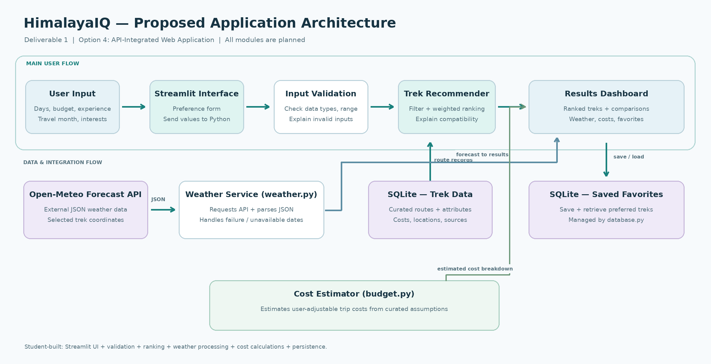
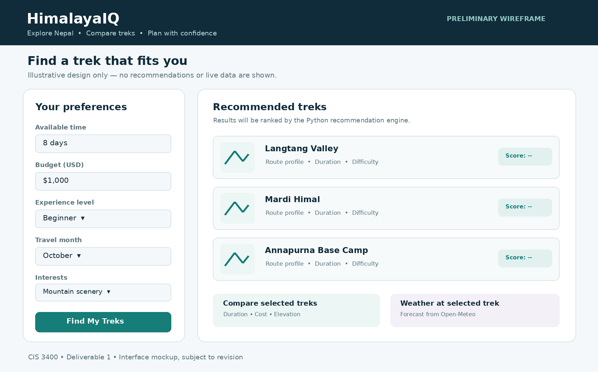

# HimalayaIQ — Smart Nepal Trek Finder

**Student:** Ankit Aryal   
**Course:** CIS 3400 — Advanced Programming  
**Project:** Project 2, Deliverable 1 — Proposal and Design  
**Date:** November 16, 2026

## 1. Problem and Intended Users

Nepal offers many trekking routes, but selecting an appropriate trek can be difficult, especially for travelers who are unfamiliar with the region. Treks vary in duration, cost, difficulty, altitude, and seasonal conditions. Travelers often need to compare information from several sources before making a decision.

**HimalayaIQ** is a proposed Python web application that helps users discover and compare trekking routes in Nepal based on their preferences. Its intended users are first-time visitors, beginner-to-intermediate trekkers, and anyone trying to choose a trek that fits their time, budget, experience, and interests.

Unlike a static list of destinations, the application will **rank treks and explain why each recommendation matches the user's preferences**.

## 2. Chosen Project Option

**Option 4 — API-Integrated Web Application.**

HimalayaIQ will integrate an external weather API and use original Python logic to validate user inputs, filter trekking routes, calculate compatibility scores, and present personalized results. It will not require a trained machine learning model.

## 3. Planned Features and Technologies

**Planned features:**
- **Preference form:** Users enter available days, budget, experience level, travel month, and preferred scenery or activities.
- **Trek recommendations:** A custom Python scoring algorithm filters and ranks routes, with brief explanations of each match.
- **Trek comparison:** Users compare estimated duration, cost, difficulty, maximum altitude, and highlights.
- **Weather information:** Users view available forecasts for selected trek locations.
- **Saved favorites (final version):** Users can save and revisit preferred routes.

**Planned technologies:**

| Technology | Purpose |
|---|---|
| Python | Validation, filtering, scoring, and comparison logic |
| Streamlit | Interactive web interface |
| SQLite (`sqlite3`) | Store curated trek records and saved favorites |
| `requests` | Retrieve weather forecasts from Open-Meteo |
| `pandas` | Organize and compare trekking data |
| `pytest` | Test recommendation logic and edge cases |

**Development milestones:** By **November 23**, the goal is a working preference form, recommendations for 2–3 routes, and one weather API integration. By **December 8**, the target is 5–6 routes, improved comparisons, saved favorites, testing, and documentation. A detailed daily itinerary planner is a possible future addition, **not** part of the initial scope.

## 4. Data / Model / API Plan

I will create a small, curated dataset of Nepal treks, starting with routes such as Langtang Valley, Mardi Himal, and Annapurna Base Camp. Each record will include its name, region, typical duration, difficulty, approximate cost range, maximum altitude, suitable seasons, location coordinates, and highlights. Route details and cost estimates will be researched and documented; estimates will be labeled as approximate.

The **recommendation engine will be rule-based, not a trained ML model**. It will first identify routes that fit key constraints, then calculate weighted scores using duration, budget, seasonal fit, and interests. Experience mismatches will be flagged rather than treated as proof that a trek is safe or unsafe.

The **Open-Meteo API** will provide forecast data for selected route locations. The app will handle unavailable forecasts and API errors gracefully. Forecasts are informational and do not replace local trail or safety guidance.

**Proposed data flow:** User preferences → Streamlit interface → Python validation and scoring → SQLite trek records + Open-Meteo weather data → ranked results and comparisons. Favorites will be stored in SQLite.

## 5. Preliminary Interface Sketch

The interface will have a **preference form on the left** and **ranked trek results on the right**. Selecting a trek will reveal its main facts, comparison details, and available weather forecast. This is a proposed design, not a screenshot of a working application.

## 6. Anticipated Challenges

- **Reliable trekking data:** Route durations, costs, and requirements vary. I will start with a limited number of researched routes and clearly label estimates.
- **Useful recommendation scores:** A simple algorithm may rank treks poorly. I will test different user profiles, review the results, and explain the factors behind each score.
- **Weather limitations:** Forecasts may be unavailable for distant dates or unreliable at high elevations. I will handle API failures and show clear forecast limitations.
- **Time management:** Building too many features could prevent a working prototype. I will prioritize the recommendation engine and weather integration before favorites or visual polish.

**Current status:** Deliverable 1 is a proposal and design. Implementation and testing are planned for Deliverables 2 and 3.
