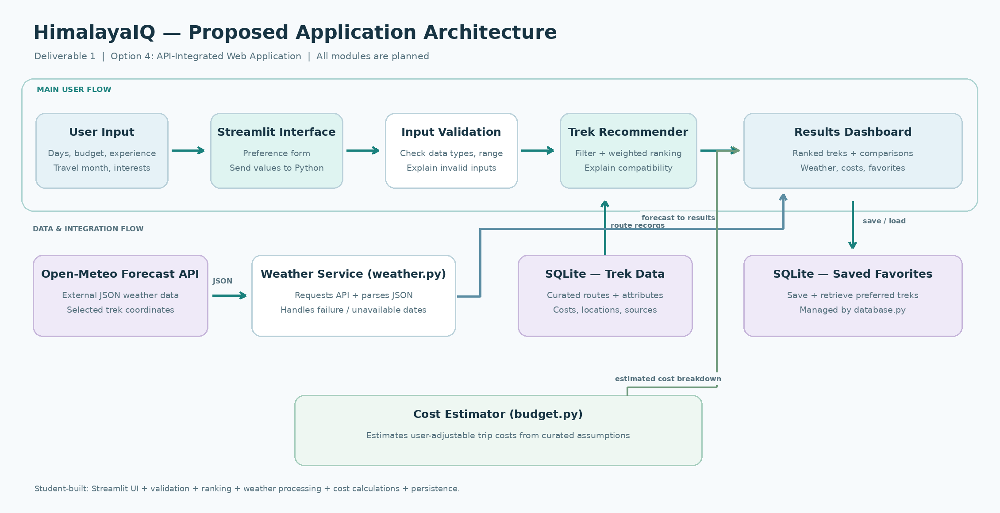
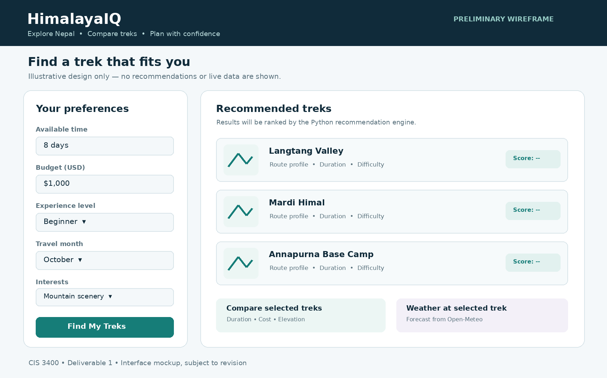

# HimalayaIQ — Smart Nepal Trek Finder

**CIS 3400 · Advanced Programming · Project 2 · Option 4: API-Integrated Web Application**
**Student:** Ankit Aryal · **Deliverable 2 deadline:** November 23, 2026

A local Streamlit prototype that filters and ranks three curated Nepal trek profiles by time, package budget, month, interests, and experience. Every score has a factor breakdown. **Compatibility describes preferences, never trekking safety.**

## Run locally (Windows PowerShell)

Use Python 3.13 (tested with 3.13.7). From this project folder:

```powershell
python -m venv .venv
.\.venv\Scripts\python.exe -m pip install -r requirements-dev.txt
.\.venv\Scripts\python.exe -m streamlit run app.py
```

Open the address Streamlit prints, normally http://localhost:8501. No environment activation or execution-policy change is needed. For application-only installation, use `requirements.txt`. Internet is needed for installation and live weather; recommendations work offline after installation.

The app automatically creates `data/himalayaiq.sqlite3`; the project folder must be writable. Reviewed JSON is the source of truth. Changed seed data refreshes SQLite transactionally. No account or API key is required for this noncommercial prototype.

## Use the prototype

1. Enter days in Nepal, package budget in USD per person, experience, month, and optional interests.
2. Press **Find my treks**. Results retain the last submitted preferences until submitted again.
3. Expand **Why this matches** for explanations and score breakdowns, or **Route details & sources** for provenance.
4. Compare returned routes. When none fit, review the time/budget exclusions.
5. Select a regional weather location and press **Load / refresh live forecast**.

Demo profiles: 14 days / $1,200 / October / Intermediate / Monasteries favors Langtang; Hot springs favors Annapurna Base Camp. Nine days / $790 returns only Mardi Himal with a partial budget match. Eight days returns no match. Beginner generates independent experience warnings.

## Consistent assumptions and sources

Profiles represent specific guided itineraries, not every possible version of each trek. Duration runs from arrival in Kathmandu through departure, including listed city stays and road transfers. International travel days and delay buffers are extra. Published fixed durations have equal minimum/maximum values; we do not invent duration ranges or compress itineraries.

**Budget is USD per person for the guided package only, not the whole holiday.** Approximate ranges span the operator's advertised group-size tiers. A lower-price match may require joining a larger group; it is not a solo quote or guaranteed availability. Group size is not inferred from user input.

Included: listed shared accommodation (some ABC dormitories), city breakfasts, three daily trekking meals, listed airport/road transfers, guide/porter services, package permits, and taxes/administration.

Extra: international airfare, visa, traveler insurance, unlisted city lunches/dinners, personal equipment, tips, snacks, water/cold drinks, showers, Wi-Fi/charging, optional upgrades/flights, extra nights and delay/emergency expenses. Budget hot drinks separately except where a route note includes them. Confirm exact minor inclusions with the provider; these are planning references, not live quotes.

First-party package sources, reviewed November 19, 2026:

- [Langtang Valley — Nepal Hiking Team](https://www.nepalhikingteam.com/package/langtang-valley-trek)
- [Mardi Himal — Nepal Hiking Team](https://www.nepalhikingteam.com/package/mardi-himal-trek)
- [Annapurna Base Camp — Nepal Hiking Team](https://www.nepalhikingteam.com/package/annapurna-base-camp-trek)

These sources document one operator's products, not independent safety assessments or market-wide prices. Each `data/treks.json` record includes sources, review dates, group-price context and altitude qualifications. Interest tags and suggested Intermediate experience are editorial classifications. All three currently share an experience category and preferred month list, so these factors affect scores but may not distinguish ranks. The ABC source table includes December while its narrative emphasizes September–November; the dataset discloses this discrepancy.

## Explainable recommendation algorithm

`recommend()` validates input and excludes profiles whose minimum duration or minimum package cost exceeds the user's limits. It never silently relaxes constraints.

| Factor | Weight | Rule |
|---|---:|---|
| Duration | 25% | Full credit when the complete itinerary fits |
| Budget | 20% | 50% at minimum price, linearly rising to 100% at maximum |
| Travel month | 15% | 100% in preferred months, 25% otherwise |
| Interests | 20% | Fraction of distinct selected interests matched |
| Experience | 20% | 100% at/above editorial expectation, 50% one level below, 0% two levels below |

`range_compatibility()` supports sourced duration/cost ranges: zero below minimum, 0.5–1 within the range, one at/above maximum. Fixed durations get full credit when they fit. More spare days never penalize a route. Empty interests remove that factor and normalize other weights. Score = 100 × weighted sum. Sorting uses unrounded scores, then name; displayed scores are rounded.

Weights live in `DEFAULT_WEIGHTS`. Scoring functions are separate; `recommend()` also accepts custom weights. Experience warnings are computed independently and persist even with zero experience weight. These thresholds are prototype design choices, not a validated predictive model.

## Weather

`weather.py` calls the [Open-Meteo Forecast API](https://open-meteo.com/en/docs) for three upcoming daily forecasts: low/high temperature (°C) and precipitation (mm), timezone `Asia/Kathmandu`. Connect/read timeouts are 5/15 seconds. Parsing checks dates, units, series lengths, and values. Missing values stay missing; no synthetic fallback is used.

Coordinates were verified with the [Open-Meteo geocoder](https://open-meteo.com/en/docs/geocoding-api): Dhunche in Rasuwa for the Langtang region, and Pokhara for both Annapurna profiles. **These are regional/gateway forecasts, not high-altitude trail forecasts.** The two Annapurna routes intentionally share weather. Weather is independent of travel month and does not affect scores. The interface shows forecast dates, retrieval time and location; API failures leave recommendations usable.

The UI retains the last explicitly loaded forecast and timestamp. Load / refresh bypasses the helper's 15-minute cache and replaces old results, including with an error on failure. Attribution: [Open-Meteo](https://open-meteo.com/) and [GeoNames](https://www.geonames.org/).

## Tests

```powershell
.\.venv\Scripts\python.exe -m pytest -q
.\.venv\Scripts\python.exe scripts/check_live_weather.py
```

Pytest runs offline: validation, known score arithmetic, constraints, interest ranking, warnings, ties, resource monotonicity, database initialization/refresh, malformed responses, network failures, and Streamlit form/error flows. Synthetic weather exists only in test fixtures. The separate smoke script makes real requests for both unique locations and exits nonzero on failure. See [Deliverable 2 status](docs/deliverable-2-status.md) for actual verification results.

## Modules and presentation guide

| File | Responsibility |
|---|---|
| `app.py` | Questionnaire, submitted session state, results, comparison and weather |
| `himalayaiq/models.py` | Explicit dataclasses for application records |
| `himalayaiq/validation.py` | Validate preferences and curated data |
| `himalayaiq/database.py` | `load_treks()` validates, refreshes SQLite and retrieves records |
| `himalayaiq/recommender.py` | `recommend()` filters, scores, explains and sorts |
| `himalayaiq/weather.py` | `fetch_forecast()` handles HTTP; `parse_forecast()` validates data |
| `himalayaiq/assumptions.py` | Shared cost/duration wording |
| `data/treks.json` | Three reviewed profiles with provenance |
| `tests/` | Offline tests including Streamlit AppTest |
| `scripts/check_live_weather.py` | Reproducible live API smoke test |

Completed prototype scope: preference form, three sourced routes, SQLite, explainable ranking, comparisons, input/error handling, initial live weather integration and basic tests. Remaining: independent data review, additional routes, high-altitude forecast points, group-size-specific pricing, favorites and broader usability testing. No machine learning or day-by-day itinerary generator.

## Original proposal and diagrams

The unchanged [Deliverable 1 proposal](docs/deliverable-1-proposal.md) is preserved separately. Its image links continue to reference the original repository layout. Both diagrams below are unchanged and describe the broader planned application, including deferred features.



