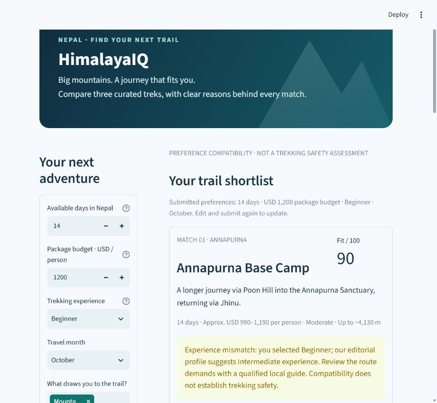

# Deliverable 2 status

Prepared November 19, 2026 (America/New_York). Submission deadline: November 23, 2026.

## Completed

- Streamlit questionnaire with days, USD/person package budget, experience, month and interests.
- Three sourced itinerary profiles, validated JSON seed, and automatically initialized SQLite storage.
- Modular filtering and ranking with the approved 25/20/15/20/20 weights, explanations and independent experience warnings.
- Ranked cards, comparison table, route/source details, no-match reasons and explicit cost/duration assumptions.
- Real Open-Meteo HTTP client, three-day regional forecasts, timeout/response validation, missing-value handling and isolated weather errors.
- Automated tests, launch instructions, presentation-oriented module guide and a saved browser preview.
- Original Deliverable 1 README preserved byte-for-byte in `deliverable-1-proposal.md`; its original relative image references are unchanged. Both original PNG diagrams are unchanged.

## Verification actually performed

Environment: Windows, Python 3.13.7, Streamlit 1.66.1, requests 2.34.2, pandas 3.0.6, pytest 9.1.1. The local `.venv` was created with access to already-installed system packages. An isolated download/install from PyPI was not tested.

| Check | Actual result |
|---|---|
| `.venv\Scripts\python.exe -m pytest -q` | **47 passed**, final run 4.09 seconds |
| `scripts/check_live_weather.py` | Both unique locations passed through the actual application HTTP client; three daily rows each |
| Browser questionnaire | Submitted default profile; saw three ranked matches, scores and Beginner warnings |
| Browser weather | Loaded real Pokhara forecast; confirmed values, units, location and retrieval timestamp |
| Browser layout | Inspected at the available desktop viewport; corrected currency math rendering and score truncation |
| Proposal preservation | Archived proposal Git blob hash matches original README: `df15c290a34f43e0bfabeee49dd8ba2089b3e8ba` |

Live API smoke checks succeeded November 19 at approximately 8:55 p.m. New York time. The returned Nepal-local forecast dates were November 20–22, 2026. UTC retrieval timestamps were `2026-11-20T01:55:18+00:00` and `2026-11-20T01:55:19+00:00`. Browser weather retrieval also succeeded at `2026-11-20T01:59:47+00:00`. Dates and values will change on subsequent requests. No weather response was fabricated or saved as a production fallback.

The first test run had 46 passes and one Streamlit cold-start timeout at its default three-second limit. Increasing the UI test timeout to 15 seconds resolved it. Final regression tests passed after the browser display fixes. Initial sandboxed networking failed DNS resolution; read-only live verification succeeded outside the sandbox. Sandboxed long-running commands also failed to produce output; tests and preview were successfully run outside that sandbox.

## Limitations and remaining work

- Three specific operator itineraries, not a comprehensive route catalog or independent price survey. Prices are approximate and group-dependent; the form does not yet ask group size.
- Weather points are Dhunche and Pokhara, not high-altitude trail locations. Both Annapurna profiles share Pokhara. Forecasts describe upcoming dates, never arbitrary future travel months.
- Editorial experience categories and preferred months are currently identical across the three profiles. These factors affect scores but do not separate these routes. Compatibility never establishes safety.
- No account system, saved favorites, machine learning, adjustable cost estimator, deployment or day-by-day itinerary generation.
- Browser verification used the available desktop viewport; comprehensive mobile/accessibility testing remains. A clean-machine dependency installation remains to be verified.
- Broader independent data review and additional route profiles are recommended before expanding use beyond a classroom prototype.

No changes were committed or pushed. The preview server used for verification is stopped after testing; use the README launch command to run it for review.

