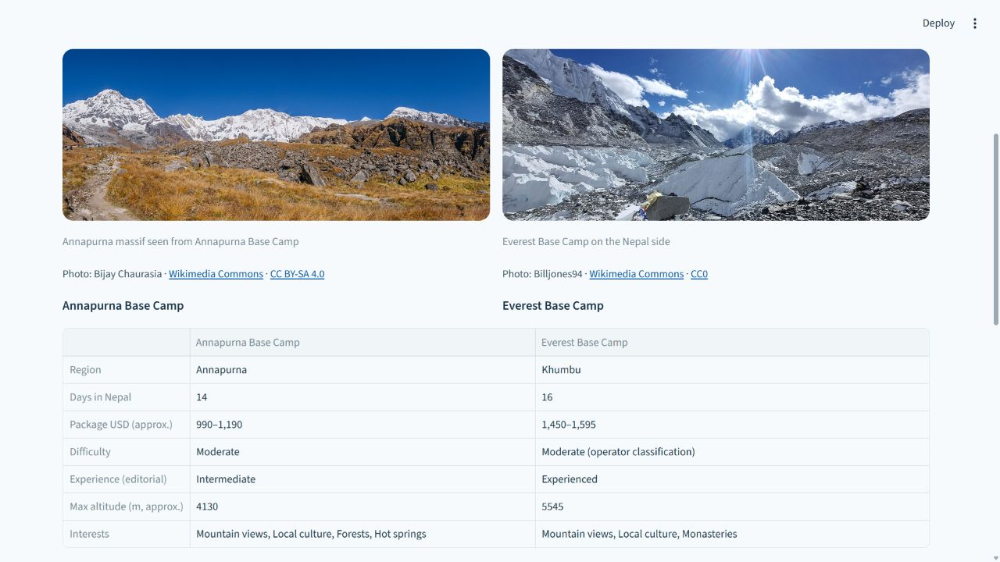

# Final application development status

Technical review build — November 20, 2026. Branch: `feature/final-development`.

## Implemented

- Six sourced trek profiles: the original three plus Ghorepani Poon Hill, Everest Base Camp and Manaslu Circuit. Profiles span 8–16 days and Beginner, Intermediate and Experienced editorial expectations.
- Original explainable scoring weights preserved. Added overflow-safe custom-weight normalization; experience warnings remain independent. Original three-route regression scenarios remain tested separately from the expanded catalog.
- Persistent local SQLite favorites with idempotent add/remove operations, explicit connection cleanup and preservation across catalog refreshes. Unavailable saved IDs are retained for explicit removal.
- Photo-based comparisons of up to four routes, all requested attributes, maximum-elevation charts and CSV export.
- Editable package-plus-extras budget estimator with decimal arithmetic, input validation, contingency, party totals and CSV export.
- Sourced landmark-elevation charts, cultural highlights, route considerations, seasonality and provenance.
- Six locally stored licensed destination photos with author/license/source records and image fallbacks. Variant captions distinguish Mardi's higher base camp and Manaslu's optional side trip. Everest is Nepal-side.
- Five-screen Streamlit interface, Himalayan palette, responsive cards, retained inputs across navigation and correctly ordered stacked mobile rankings.
- Four verified weather locations, three-day forecast cards, explicit settlement context, real HTTP integration, readable errors and missing-value handling.
- Technical README updated. Deliverable 1 proposal, Deliverable 2 status report and original diagrams preserved unchanged.

## Verification performed

Windows / Python 3.13.7. Direct dependencies: Streamlit 1.66.1, requests 2.34.2, pandas 3.0.6, Pillow 13.0.0, pytest 9.1.1.

| Check | Verified result |
|---|---|
| Phase 1 regression suite | 62 passed before favorites/budget service commit |
| Phase 2 integration suite | 72 passed before catalog/interface commit |
| Final full suite in clean environment | **76 passed in 30.36 seconds** |
| Clean installation | `pip install -r requirements-dev.txt` succeeded in `.venv-verify`, with system packages disabled |
| Clean dependency consistency | `pip check`: no broken requirements |
| Clean Streamlit launch | Server launched on localhost; `/_stcore/health` returned HTTP 200, `ok` |
| Real weather smoke check | Dhunche, Pokhara, Namche Bazaar and Kathmandu each returned three daily forecast rows |
| Browser checks | Desktop Explore/results, comparison/photo rendering, budget screen and real weather cards inspected |
| Mobile check | 390 × 844 viewport inspected; document width 390, no horizontal page overflow; loaded images verified |
| SQLite persistence | Automated separate-session add/view/remove, duplicate saves, invalid IDs and catalog-refresh preservation passed using isolated databases |
| Inputs/navigation | Automated retained preferences/budget values, empty comparison, no matches, cleared numeric input, forecast route-switch isolation and API failure flows passed |
| Preservation | Git diff against main shows no changes to original proposal, D2 status or original diagrams |

Live weather checks on November 20 returned Nepal-local dates November 21–23, 2026. Retrieval timestamps: `2026-11-20T19:55:43+00:00` through `19:55:45+00:00`. A real Pokhara forecast was also displayed in the browser at `19:59:34+00:00`. Synthetic responses are confined to tests.

The final test run includes fixes for screen-navigation input resets, mobile card ordering, large-weight overflow, incomplete photo metadata, a legacy HTTP CC0 license URL, mixed-type comparison serialization, redundant widget defaults and cleared numeric input handling. An early budget test had incorrect expected arithmetic; it was corrected to the independently summed category total. A temporary approval-review usage-limit failure interrupted verification; work resumed successfully after the limit reset.

## Remaining limitations

- Package data comes from one operator's specific itineraries. Independent cross-source review, live quotes and group-size-aware pricing are not implemented.
- Weather is settlement-level: Kathmandu is only the Manaslu arrival city, not trail weather. No whole-route or summit forecast is claimed.
- Elevation charts compare selected landmarks; no GPS-derived continuous profile or itinerary generator is implemented.
- Budget extras require user estimates; scenarios are session-only, with category CSV export. Favorites are local/shared per installation, without accounts or cloud sync.
- Images depict the named destinations or explicitly labeled variants. A future photo pass could select exact itinerary-endpoint views for every card.
- Browser checks cover one desktop viewport and a simulated mobile breakpoint, not every device, browser or assistive technology.
- No deployment, authentication, machine learning, chatbot or paid service was added. Academic presentation and submission materials were intentionally not prepared.

## Git and local review

`main` remains at `79c0344929c66096d0af9b47b0698a1235ee819c`, the preserved Deliverable 2 commit. Work was committed and pushed in phases to [feature/final-development](https://github.com/aryalankit121/HimalayaIQ/tree/feature/final-development). No merge, history rewrite or force-push was performed.

The verification server is stopped after testing. Run locally from the project folder:

```powershell
git switch feature/final-development
python -m venv .venv
.\.venv\Scripts\python.exe -m pip install -r requirements-dev.txt
.\.venv\Scripts\python.exe -m streamlit run app.py
```



Screenshot photograph credits: Annapurna image by Bijay Chaurasia (CC BY-SA 4.0), Everest image by Billjones94 (CC0). Full source/license links are in `assets/image-credits.json` and visible in the screenshot.
